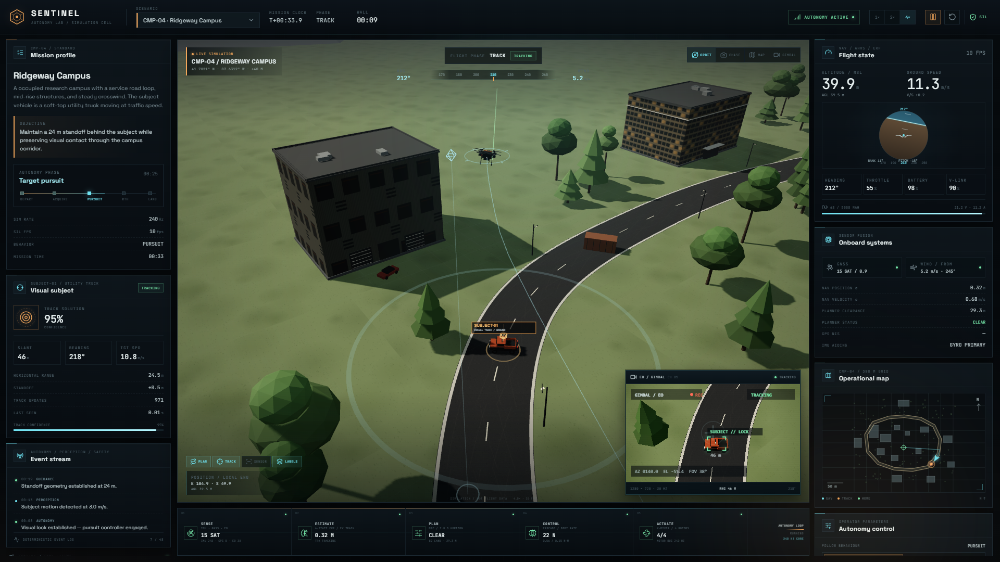

# Sentinel Autonomy Lab

**A browser-native, physics-driven autonomy testbed for visual target following.**

Sentinel is not a cinematic drone demo with animation curves. It is a deterministic simulation of a 2.35 kg quadrotor, a moving ground subject, and the perception / estimation / planning / control stack required to follow that subject. The simulation core is renderer-independent and runs at 240 Hz; the browser is only a view onto snapshots of that core.



## At a glance

- **6-DOF quadrotor dynamics** — thrust allocation, per-motor lag, inertia, rotor drag, aerodynamic drag, wind turbulence, battery sag.
- **Noisy sensor simulation** — 240 Hz IMU with bias/random walk, 8 Hz GNSS, 20 Hz barometer, 50 Hz magnetometer, 30 Hz EO camera with a co-boresighted laser rangefinder.
- **Separated estimation and autonomy** — 6-state navigation Kalman filter, constant-velocity target tracker, gimbal detector, sampling-based receding-horizon planner, PX4-style cascaded controller, mission state machine and failsafes.
- **Truth is never fed to the autonomy stack.** The mission, tracker, planner and controller only see sensor-derived estimates. Ground truth is used by the renderer and by the evaluation layer.
- **Three scenarios** with different maps, wind, target behaviour, visibility and altitude constraints.
- **Deterministic** fixed-step core (`SIM_DT = 1/240`) and a seeded scenario catalogue. The same scenario and seed produce identical drone and target state to numerical precision in the tests.
- **20 automated checks** covering math conventions, obstacle geometry, route generation, target-tracker convergence, hover control, determinism, and 60-second closed-loop missions in all three scenarios.

## Quick start

Requirements: Node.js 20+ and a browser with WebGL 2.

```bash
npm install
npm run dev
```

Open the URL printed by Vite (by default `http://127.0.0.1:5173`).

Production build and tests:

```bash
npm run build
npm test
npm run typecheck
npm run check   # typecheck + tests + production build
```

The app runs entirely locally. There is no backend, no API key, and no external asset fetch at runtime.

## Flying it

The mission launches automatically. The operator can:

- **Pause / resume** the fixed-step simulation.
- **Change scenario** — the world is regenerated from a deterministic seed.
- **Change camera** — ORBIT, CHASE, MAP (top-down), or GIMBAL (full-screen EO feed).
- **Toggle overlays** — planned path, target estimate, sensor frustum/laser, labels.
- **Switch follow behaviour** — PURSUIT trails behind the subject; OVERWATCH orbits the subject at the current standoff.
- **Tune standoff and wind injection live** — autonomy continues to use estimates, so changed disturbances must be rejected by the controller.
- **View the EO feed** — a second render pass from the stabilized gimbal, with target brackets, track state and range overlays.

The console is intentionally an operations surface: every panel is driven by the same `SimulationSnapshot` that is exposed to the renderer and tests, not by separate UI-only state.

## Scenarios

| Code | Map | Subject | Cruise | Drone altitude | Standoff | Wind | Primary difficulty |
|---|---|---|---|---:|---:|---:|---|---|
| `CMP-04` | Ridgeway Campus | Utility truck | 10.5 m/s | 40 m | 24 m | 4.2 m/s | Dense mid-rise skyline, occlusion, road-loop turns |
| `BPC-11` | Blackpine Corridor | Forest-service pickup | 8.3 m/s | 16 m | 15 m | 2.6 m/s | Low altitude, tall canopies, narrow sight lines |
| `DCR-02` | Dry Creek Range | Range runner | 15.0 m/s | 28 m | 30 m | 9.0 m/s | Fast target and strong crosswind disturbance |

Each scenario defines its own route, buildings, trees, props, lighting, fog, wind field and subject dynamics. The target starts with a departure delay so the drone can complete its vertical departure and acquire the subject before it moves.

## How the autonomy works

```
 EO camera + laser ──► pinhole projection / occlusion test / measurement noise ──► target CV Kalman filter
 IMU + GNSS + baro  ──► 6-state navigation filter + gyro-primary AHRS ──────────┐
                                                                                 ▼
 operator cue / track estimate                                              mission state machine
                                                                                 │
                                                         desired standoff viewpoint
                                                                                 │
                                                                       sampling MPC (10 Hz)
                                                                                 │
                                                              waypoint + velocity feed-forward
                                                                                 │
                                                       cascaded controller (100 Hz)
                                                                                 │
                                                     thrust / torque allocation (240 Hz)
                                                                                 │
                                                                       6-DOF rigid body
```

### 1. Flight dynamics

The airframe is an X-configuration quadrotor. The controller emits a collective thrust and body torque; an allocation matrix maps them to four rotor thrusts, and each rotor follows a first-order speed lag. Actual rotor thrust is `kT·ω²`, so saturation and actuator lag both have physical consequences. The rigid body integrates:

- world-frame translation with gravity, quadratic body drag and relative-air wind,
- body angular momentum with gyroscopic coupling and angular damping,
- quaternion orientation from body angular velocity.

Parameters are collected in `DEFAULT_DRONE_PARAMETERS` (`src/core/sim/drone.ts`); mass, arm length, inertia, thrust coefficient and motor time constant are all editable.

### 2. Sensors and estimation

The IMU is sampled at 240 Hz with bias, random walk and white noise. GNSS (8 Hz) and barometer (20 Hz) provide position corrections. The navigation filter is a 6-state linear Kalman filter (position and velocity) with Joseph-form covariance updates and innovation gating.

Attitude is deliberately treated as a **gyro-primary AHRS**. The accelerometer only aids attitude in quasi-static flight, because an accelerometer on a thrust-vectoring vehicle measures specific force, not gravity; using it during a banked acceleration injects a false tilt. This failure mode is visible and documented in `AttitudeEstimator` — the filter chooses gyro propagation when the vehicle is dynamic. In a production design this would be replaced with a full 15-state EKF with GNSS-velocity aiding.

The target tracker is a 6-state constant-velocity Kalman filter in world coordinates. It consumes laser-ranged camera measurements, applies an innovation gate, clamps implausible target speed, and exposes `SEARCHING / ACQUIRING / TRACKING / COASTING / LOST` states with covariance-derived confidence. The host aircraft's GNSS position is never used to compute target truth.

### 3. Visual detection

`TargetDetector` simulates a 1280×720 EO payload with a 38° horizontal field of view:

- target projected into camera coordinates,
- horizontal/vertical FOV gate,
- exact segment–AABB and segment–cylinder occlusion tests against buildings and tree canopies,
- angular measurement noise and range noise from the laser,
- 3.5% laser dropouts,
- screen coordinates for the FPV overlay.

This is a geometric sensor model, **not a learned detector**. It is the correct abstraction for testing tracking and guidance logic independently of a particular neural network.

### 4. Guidance and planning

`LocalPlanner` is a sampling-based receding-horizon controller. It rolls out 82 constant-velocity candidates (9 headings × 3 speeds × 3 vertical choices, plus hover) over a 2 s horizon and scores:

- velocity tracking against a preferred velocity (target velocity + bounded closing term),
- goal distance and progress,
- 3D obstacle clearance with a hard minimum,
- line-of-sight to the subject,
- smoothness and altitude deviation.

The selected command is low-pass filtered but re-checked for collision before being used. A separate emergency mode generates an escape velocity if current clearance drops below 3 m. The planner emits a short look-ahead waypoint plus velocity feed-forward rather than a raw acceleration, keeping the interface close to a real companion-computer / flight-controller boundary.

The mission layer chooses a valid standoff viewpoint around the estimate, not just a point behind it. Candidates are scored on map clearance, line of sight to the target, deviation from the desired geometry, travel distance and hysteresis. This prevents the follower from commanding a viewpoint inside a building when the subject rounds a corner.

### 5. Control and mission logic

The controller is a PX4-style cascade:

```
position P → velocity PI → acceleration → thrust vector
           → attitude P → body-rate PI → torque
```

Limits are explicit: horizontal/vertical speed, acceleration, maximum tilt, body rate, torque and collective thrust. The controller runs at 100 Hz on the navigation estimate and zero-order-holds actuator commands until the next update.

The mission state machine covers `TAKEOFF → ACQUIRE → TRACK → LOST → RTH → LAND → COMPLETE` plus `FAILED`, with:

- target-loss contingency search around the last known point,
- battery reserve and critical-battery failsafes,
- geofence return-to-home,
- terminal descent and disarm,
- explicit camera cue / aim behavior,
- event-log entries for every operator-visible transition.

## Verification

The tests do not instantiate Three.js or the DOM. They exercise the pure simulation core.

| Area | What is checked |
|---|---|
| Math | Quaternion body conventions, shortest-arc error, route arc-length, matrix inversion |
| World | Closed route generation, obstacle penetration, line-of-sight occlusion, wind direction |
| Estimation | Target tracker converges to a noisy constant-velocity subject; coast horizon produces `LOST` |
| Control | Sensor-clean hover stays within ±0.6 m of the setpoint |
| Autonomy | 60 s closed-loop runs in all three scenarios: no crash, `TRACK` phase, tracked subject, standoff error < 20 m, tracker error < 9 m, battery reserve preserved, no critical events |
| Determinism | Two independent `Simulation` instances produce identical state for the same seed |

Run `npm test` for the current results. The tests are intentionally headless and deterministic, so they can run in CI without a GPU.

## Engineering boundary

The simulation core (`src/core`) has no React, DOM, Three.js or WebGL imports. `Simulation.step()` is a pure fixed-step update of the world model. The renderer consumes a `SimulationSnapshot`; the UI consumes the same snapshot. This boundary is what makes the project more than a visual prototype:

- dynamics can be tested without a browser,
- sensor rates and controller timing are explicit,
- deterministic replay is possible,
- a future SITL bridge (MAVLink/PX4, ROS 2, or a native flight stack) can replace the core without changing the visual layer.

## Deliberate limitations

I would rather state these than imply a level of fidelity the project does not have:

- The collision ground is flat. Distant terrain and mountains are visual only.
- Obstacles are a preloaded 2.5D map. There is no onboard SLAM and no moving obstacle detection.
- The airframe model omits blade flapping, ground effect, thermal effects, ESC voltage dynamics and detailed motor electrical models.
- The target detector is geometric; it does not model motion blur, rolling shutter, lens distortion or a classifier.
- The AHRS is gyro-primary with gated gravity/heading aiding. It is adequate for the demonstrated flights but is not a full 15-state navigation EKF.
- Wind is a horizontal mean + OU gust field; no shear layers, thermals or downbursts.
- The renderer and simulation share the main thread. A production training environment would run the core in a worker or native process.
- This is a simulation and engineering demonstration, not flight-certified software or a substitute for hardware-in-the-loop testing.

## Project layout

```
src/
  core/                 pure simulation core (no DOM / Three.js)
    math/               vectors, quaternions, matrices, seeded RNG
    world/              scenarios, routes, obstacles, wind
    sim/                dynamics, sensors, estimation, control, planning, mission, snapshots
  render/               Three.js scene, models, textures, camera rig, FPV overlays
  ui/                   React operations console
  app/                  fixed-step runtime + snapshot publishing
tests/                  headless unit and integration tests
docs/                   architecture and screenshots
```

See [`docs/architecture.md`](docs/architecture.md) for timing, coordinate conventions, equations and extension points.

## References and background

- PX4 controller architecture and cascaded position/attitude diagrams: [PX4 Controller Diagrams](https://docs.px4.io/v1.15/en/flight_stack/controller_diagrams)
- PX4 EKF2 overview, useful context for the estimator boundary: [PX4 EKF2](https://docs.px4.io/main/en/advanced_config/tuning_the_ekf.html)
- R. Mahony, T. Hamel, J.-M. Pflimlin, “Nonlinear Complementary Filters on the Special Orthogonal Group,” *IEEE TAC*, 2008.

The implementation is original and self-contained; the external material informs the control and estimation architecture, not the code.

## License

MIT — see [`LICENSE`](LICENSE).
